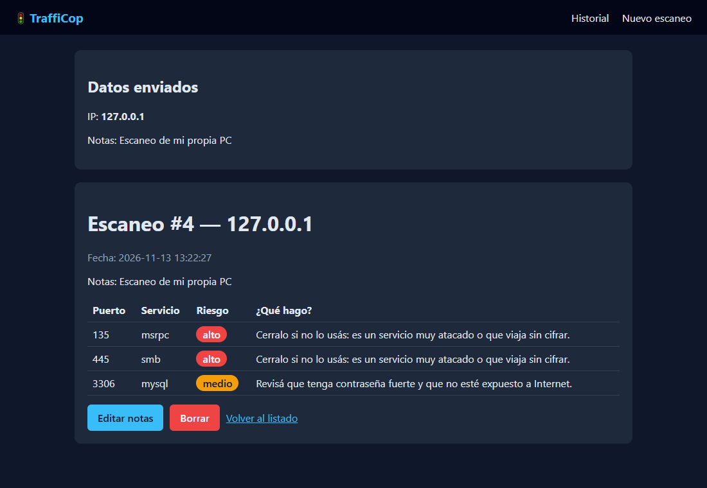
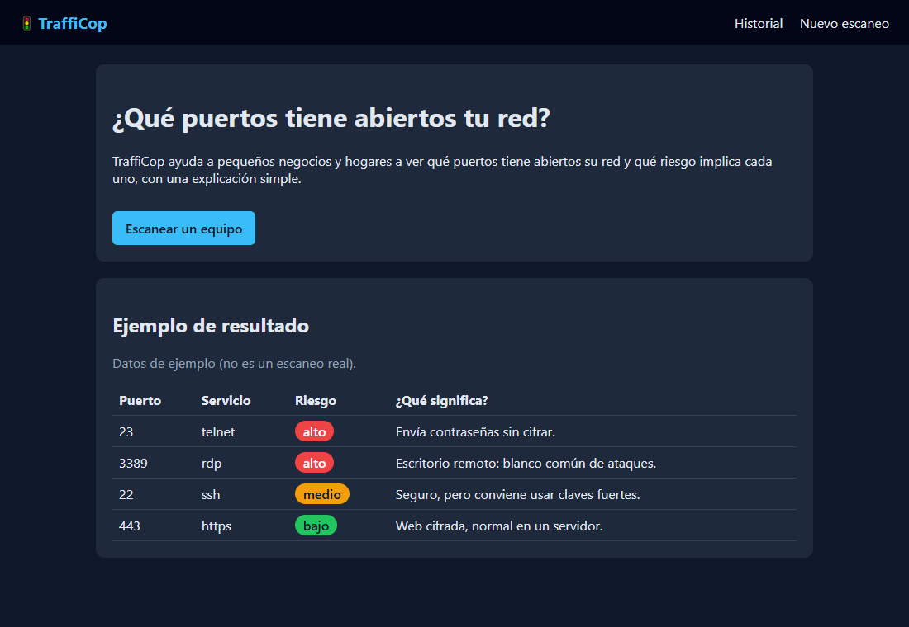
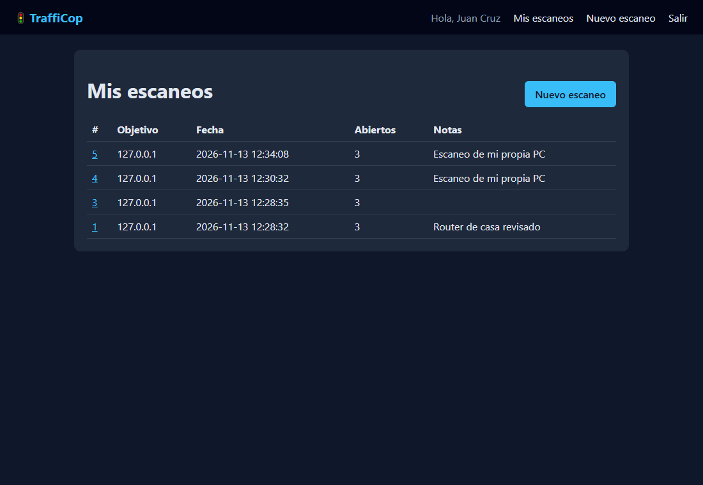
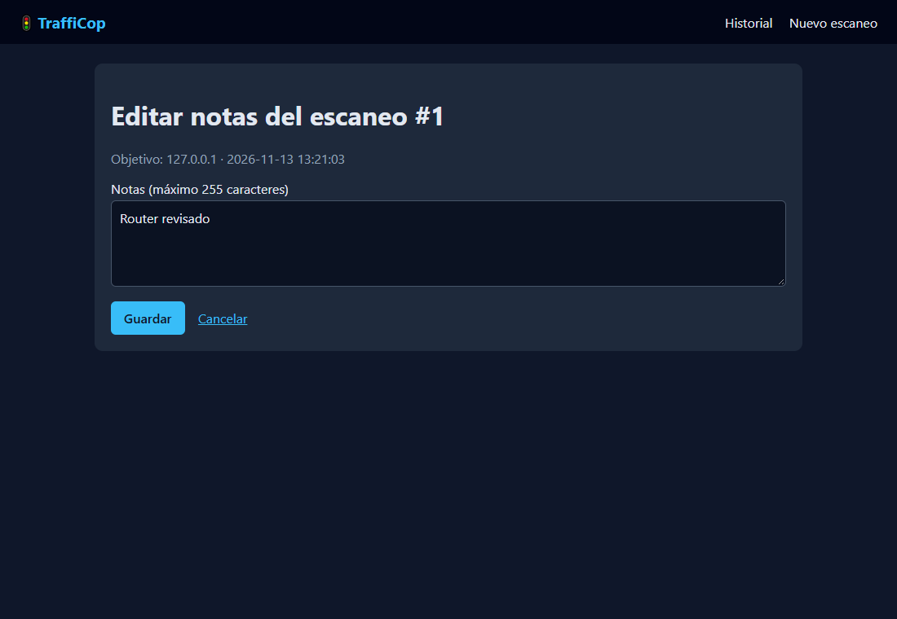

# 🚦 TraffiCop

MVP que analiza qué puertos están abiertos en un equipo de la red local y muestra el resultado en una web, con el riesgo de cada puerto explicado de forma simple.

> **Elevator pitch:** TraffiCop ayuda a pequeños negocios y hogares a ver qué puertos tiene abiertos su red y qué riesgo implica cada uno, con una explicación simple.



## Integrantes

| Nombre | GitHub | Rol |
|---|---|---|
| Juan Cruz | [@Gambeta-Latorre](https://github.com/Gambeta-Latorre) | Desarrollo completo (trabajo individual) |

**Escuela:** E.E.S.T. N°4 Berazategui — **Materia:** PDI Sistemas Computacionales 7°2 — **Docentes:** Fabricio Futryk y Diego Pezet

**Kanban (GitHub Project):** <https://github.com/users/Gambeta-latorre/projects/3> — **Issues (historias):** <https://github.com/Gambeta-latorre/pdi-eest4/issues>

## Tecnologías

- **Backend web:** PHP 8.2+ con Slim 4 (`slim/slim`, `slim/psr7`, `slim/php-view`, `vlucas/phpdotenv`) y Composer.
- **Base de datos:** MySQL / MariaDB con PDO y prepared statements.
- **Escáner:** Python 3 (`scanner/escanear.py`), solo librería estándar, con threads y salida JSON. PHP lo ejecuta con `proc_open` pasando los argumentos como array (sin shell, no hay inyección de comandos).
- **Seguridad:** solo se pueden escanear IPs privadas (10.x, 172.16–31.x, 192.168.x) o loopback (127.x); se valida en PHP **y** en Python.

## Cómo instalar y correr

Requisitos: PHP 8.2 o más nuevo con `pdo_mysql`, Composer, Python 3 y MySQL/MariaDB (por ejemplo el de XAMPP).

```bash
composer install
```

```bash
cp .env.example .env
```

Editá `.env` con el usuario y la contraseña de tu MySQL (y `PYTHON_BIN=python3` si estás en Linux). Después creá la base (si no existe, `composer migrate` también la crea):

```bash
mysql -u root -e "CREATE DATABASE IF NOT EXISTS trafficop CHARACTER SET utf8mb4"
```

```bash
composer migrate
```

```bash
php -S localhost:8000 -t public
```

Abrí <http://localhost:8000> y escaneá `127.0.0.1` (tu propia PC). No hace falta crear cuenta: por indicación docente, la app no tiene login.

## Arquitectura (TP14)

```
public/index.php          punto de entrada
src/bootstrap.php         arma la app: .env, middlewares, dependencias y rutas
src/routes/               solo conectan URL -> método del controlador
src/controllers/          validan lo que llega y eligen la vista / status
src/services/             lógica (transacciones, ejecutar el escáner)
src/persistence/          única capa que habla con la base (PDO)
src/middlewares/          LogMiddleware (global: registra cada petición)
src/views/                vistas PHP con layout.php (PhpRenderer)
src/database/migrations/  SQL numerado
scripts/migrate.php       ejecuta las migraciones (composer migrate)
scanner/escanear.py       escáner de puertos en Python
```

Flujo de una petición: `ruta → controlador → service → persistencia → base`, y la respuesta vuelve al controlador que renderiza la vista.

### Base de datos

- `escaneos` (id, objetivo, fecha, notas, resultados JSON, usuario_id opcional)
- `usuarios` (id, nombre, email **único**, password_hash): viene de las migraciones 001–005 del TP10. Desde que se quitó el login no se usa, y la migración 007 hace `escaneos.usuario_id` opcional (NULL).
- `puertos` (id, escaneo_id → escaneos, puerto, servicio, riesgo alto/medio/bajo) — `ON DELETE CASCADE`
- `migraciones` (registro de qué migraciones ya se ejecutaron)

### Clasificación de riesgo

| Riesgo | Puertos |
|---|---|
| Alto | 21 ftp, 23 telnet, 135 msrpc, 139 netbios, 445 smb, 3389 rdp, 5900 vnc |
| Medio | 22 ssh, 25 smtp, 110 pop3, 143 imap, 3306 mysql, 5432 postgresql |
| Bajo | 53 dns, 80 http, 443 https, 8000 / 8080 http alternativos |

## Rutas

| Método | Ruta | Descripción |
|---|---|---|
| GET | `/` | Landing con datos de ejemplo |
| GET | `/escaneos?limit=N` | Historial de escaneos (limit opcional, entero positivo) |
| GET | `/escaneos/create` | Formulario de nuevo escaneo |
| POST | `/escaneos` | Ejecuta el escaneo, lo guarda y muestra datos enviados + resultado |
| GET | `/escaneos/{id}` | Detalle con puertos y riesgo (404 → `not_found`) |
| GET | `/escaneos/{id}/edit` | Formulario para editar notas |
| PUT | `/escaneos/{id}` | Edita notas (máx. 255 caracteres, si no 422) — `_METHOD=PUT` |
| DELETE | `/escaneos/{id}` | Borra el escaneo y sus puertos — `_METHOD=DELETE` |

Los formularios HTML solo envían GET y POST: para PUT y DELETE se agrega un campo oculto `_METHOD` que lee `MethodOverrideMiddleware`.

## TP → dónde está resuelto

| TP | Tema | Dónde |
|---|---|---|
| 3 | Git y GitHub | Este repo, [`.gitignore`](.gitignore), [`LICENSE`](LICENSE), este README, historial de commits chicos |
| 4 | User Story Mapping | [`docs/TP04-user-story-mapping.md`](docs/TP04-user-story-mapping.md) y [PDF](docs/TP04-user-story-mapping.pdf) |
| 5 | Kanban y backlog | GitHub Project (link arriba) con columnas Backlog, Ready, In progress, In review y Done; [`.github/ISSUE_TEMPLATE/historia-de-usuario.md`](.github/ISSUE_TEMPLATE/historia-de-usuario.md) |
| 6 | Slim + landing | [`public/index.php`](public/index.php), [`src/bootstrap.php`](src/bootstrap.php), [`src/views/index.php`](src/views/index.php), [`HomeController`](src/controllers/HomeController.php) |
| 7 | Rutas con vistas | `GET /escaneos`, `/escaneos/{id}`, `/escaneos/create` en [`escaneos.routes.php`](src/routes/escaneos.routes.php) y [`src/views/escaneos/`](src/views/escaneos) |
| 8 | Body | `POST /escaneos` → `EscaneoController::store` muestra datos enviados y resultado |
| 9 | Query params | `?limit=N` validado en `EscaneoController::index` |
| 10 | Migraciones | [`src/database/migrations/`](src/database/migrations) (001–007) y [`scripts/migrate.php`](scripts/migrate.php) |
| 11 | CRUD con transacciones | `EscaneoService::enTransaccion()` en [`EscaneoService.php`](src/services/EscaneoService.php); vistas index, create, update, show, not_found |
| 12 | Middlewares | [`LogMiddleware`](src/middlewares/LogMiddleware.php) global → consola y `logs/app.log`. El login (auth) se quitó por indicación docente. |
| 13 | Rutas modulares | [`src/routes/`](src/routes): `home.routes.php` y `escaneos.routes.php`, cargados con `require` en `bootstrap.php` |
| 14 | Arquitectura en capas | `src/routes → src/controllers → src/services → src/persistence` (ver sección Arquitectura) |
| 15 | Backlog MVP | [`docs/TP15-backlog-mvp.md`](docs/TP15-backlog-mvp.md) + un issue por historia en el Project (MVP en Done, versión 2 en Backlog) |
| Checkpoint | Lógica de programación | [`docs/checkpoint-diagramas.md`](docs/checkpoint-diagramas.md) (Mermaid) y PNG en [`docs/diagramas/`](docs/diagramas) |

## Capturas

| Landing | Listado | Editar notas |
|---|---|---|
|  |  |  |

## Licencia

[MIT](LICENSE)
