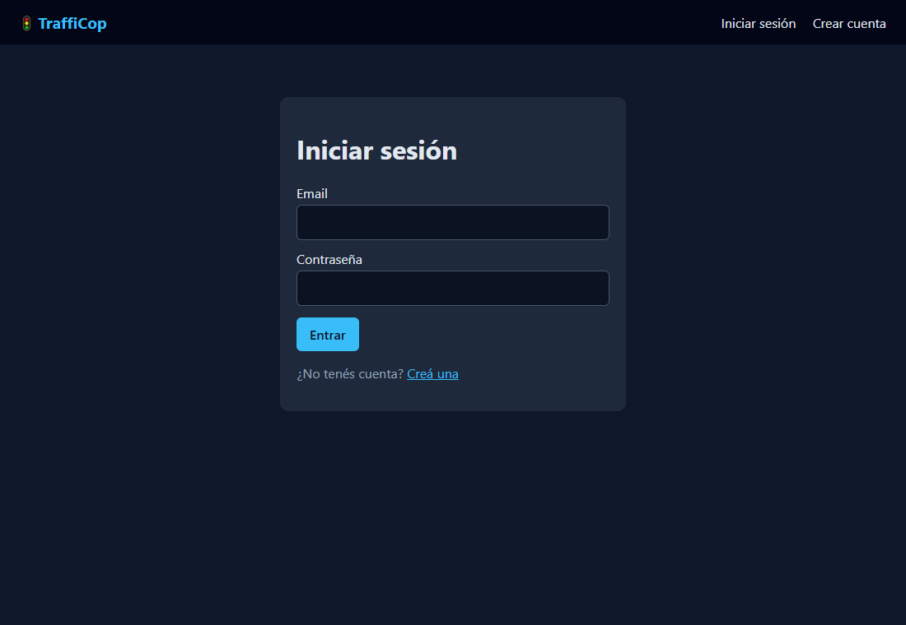
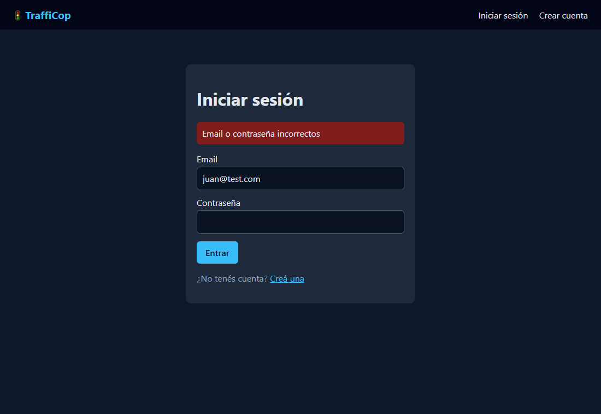

# TP4 — User Story Mapping de TraffiCop

**Alumno:** Juan Cruz (GitHub: Gambeta-Latorre) — E.E.S.T. N°4 Berazategui, PDI Sistemas Computacionales 7°2

**Docentes:** Fabricio Futryk y Diego Pezet

> **Nota posterior:** este mapa es la planificación entregada en el TP4. Después, por indicación docente, el registro y el inicio de sesión dejaron de ser necesarios y se quitaron de la aplicación. El backlog actualizado está en [TP15](TP15-backlog-mvp.md).

> TraffiCop ayuda a pequeños negocios y hogares a ver qué puertos tiene abiertos su red y qué riesgo implica cada uno, con una explicación simple.

**Usuario principal:** dueño de un pequeño negocio o persona en su casa, sin conocimientos técnicos de redes, que quiere saber si su red está expuesta.

## 1. Mapa de historias

Las **actividades** son los grandes objetivos del usuario (de izquierda a derecha, en el orden en que los hace). Debajo de cada una están los **pasos** y, debajo, las **historias**. Las historias marcadas con ⭐ forman el **MVP** (primera versión entregable); el resto queda para versiones siguientes.

| Actividad → | 1. Conocer la herramienta | 2. Entrar a mi cuenta | 3. Escanear mi red | 4. Entender el resultado | 5. Llevar un historial |
|---|---|---|---|---|---|
| **Pasos** | Ver la página de inicio | Registrarme · Iniciar sesión · Salir | Cargar la IP · Ejecutar el escaneo | Ver puertos abiertos · Ver riesgo y consejo | Ver mis escaneos · Anotar · Borrar |
| **Historias MVP ⭐** | ⭐ Ver landing con ejemplo | ⭐ Registro con email y contraseña ⭐ **Inicio de sesión con email y contraseña** ⭐ Cerrar sesión | ⭐ Nuevo escaneo de una IP privada | ⭐ Ver resultado con riesgo alto/medio/bajo y explicación | ⭐ Historial con límite (`?limit=N`) ⭐ Editar notas ⭐ Borrar escaneo |
| *Versión 2* | Ver preguntas frecuentes | Recuperar contraseña por email | Escanear un rango de IPs (toda la red) | Exportar el resultado a PDF | Comparar dos escaneos del mismo equipo |
| *Versión 3* | Video tutorial | Ingreso con Google | Escaneo programado (cada semana) | Guía paso a paso para cerrar cada puerto en el router | Alertas por email si aparece un puerto nuevo |

**Línea del MVP:** todo lo que está en la fila ⭐. Con eso el usuario puede crear su cuenta, escanear un equipo de su red, entender qué significa cada puerto abierto y guardar el historial.

## 2. Detalle de la historia: "Inicio de sesión con email y contraseña"

**ID:** HU-02 — **Prioridad:** alta (MVP) — **Estimación:** 3 puntos

**Como** usuario registrado de TraffiCop
**quiero** iniciar sesión con mi email y mi contraseña
**para** acceder a mis escaneos guardados y que nadie más pueda verlos.

### Criterios de aceptación

1. **Login correcto:** dado que tengo una cuenta, cuando ingreso mi email y mi contraseña correctos en `/auth/login`, entonces se inicia mi sesión y soy redirigido a `/escaneos` (respuesta 302).
2. **Contraseña incorrecta:** dado que ingreso un email existente con una contraseña equivocada, entonces sigo en la pantalla de login, veo el mensaje "Email o contraseña incorrectos" y la respuesta es 401.
3. **Email inexistente:** dado que ingreso un email que no está registrado, entonces veo el mismo mensaje genérico (no se revela si el email existe).
4. **Campos obligatorios:** el formulario no se envía si el email o la contraseña están vacíos.
5. **Contraseña segura:** la contraseña se guarda como hash (`password_hash`) y se compara con `password_verify`; nunca se guarda en texto plano.
6. **Rutas protegidas:** si no inicié sesión e intento entrar a cualquier ruta de `/escaneos`, soy redirigido a `/auth/login`.
7. **Cerrar sesión:** al entrar a `/auth/logout` se destruye la sesión y vuelvo a la página de inicio.

### Captura de la pantalla de login (proyecto funcionando)

Login con datos incorrectos (criterio 2):

