# Checkpoint "Lógica de Programación Aplicada" — Diagramas de flujo

Un diagrama de flujo por cada historia de usuario del MVP (ver [TP15](TP15-backlog-mvp.md)). La aplicación no tiene login (se quitó por indicación docente), así que ningún flujo pide sesión.
Convenciones: **óvalo** = inicio/fin, **rombo** = decisión, **paralelogramo** = entrada/salida de datos, **rectángulo** = proceso.
Cada diagrama también está exportado a PNG en [`docs/diagramas/`](diagramas/).

## US-1 Ver la landing

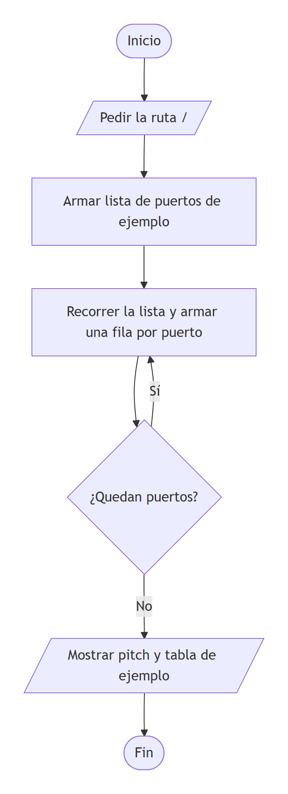

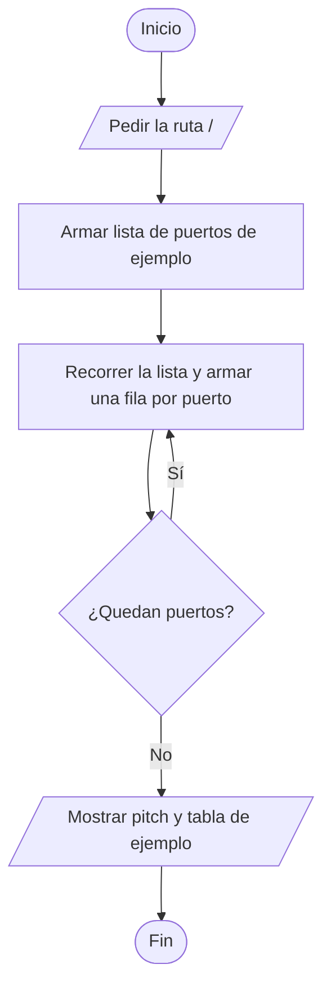

## US-2 Nuevo escaneo de una IP privada

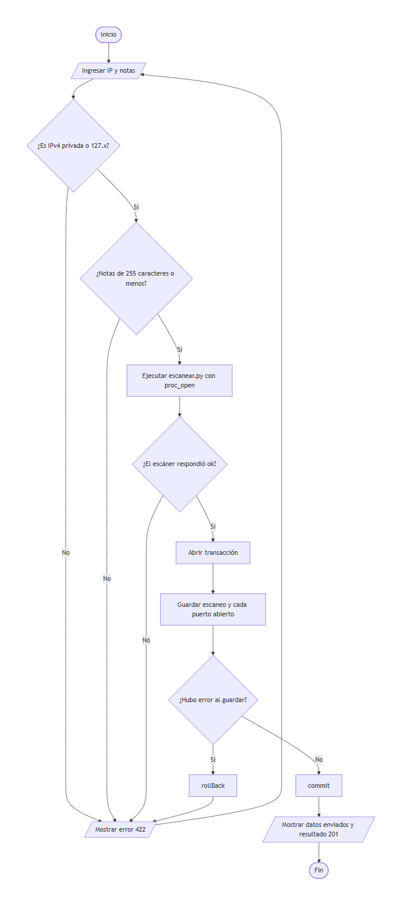

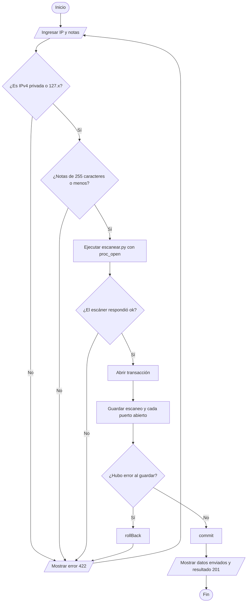

## US-3 Ver resultado con riesgo

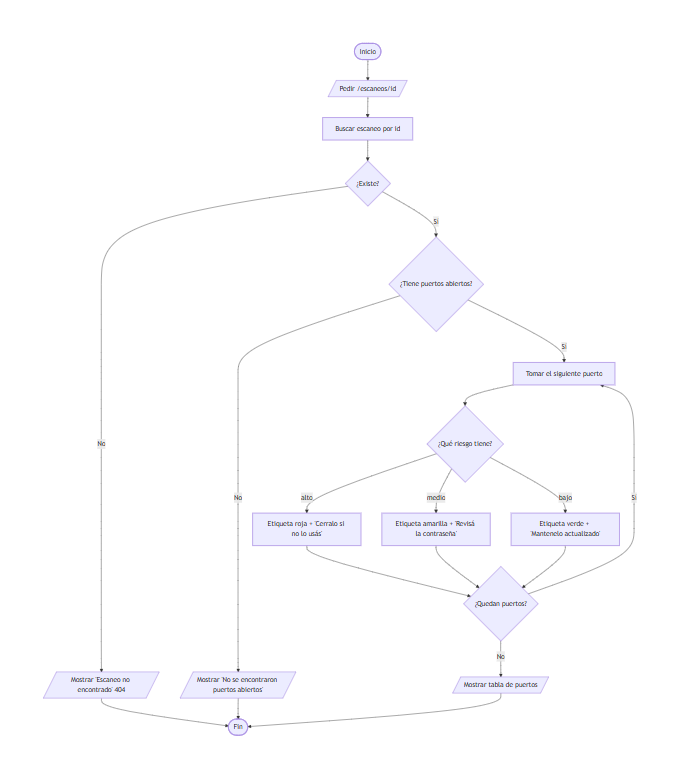

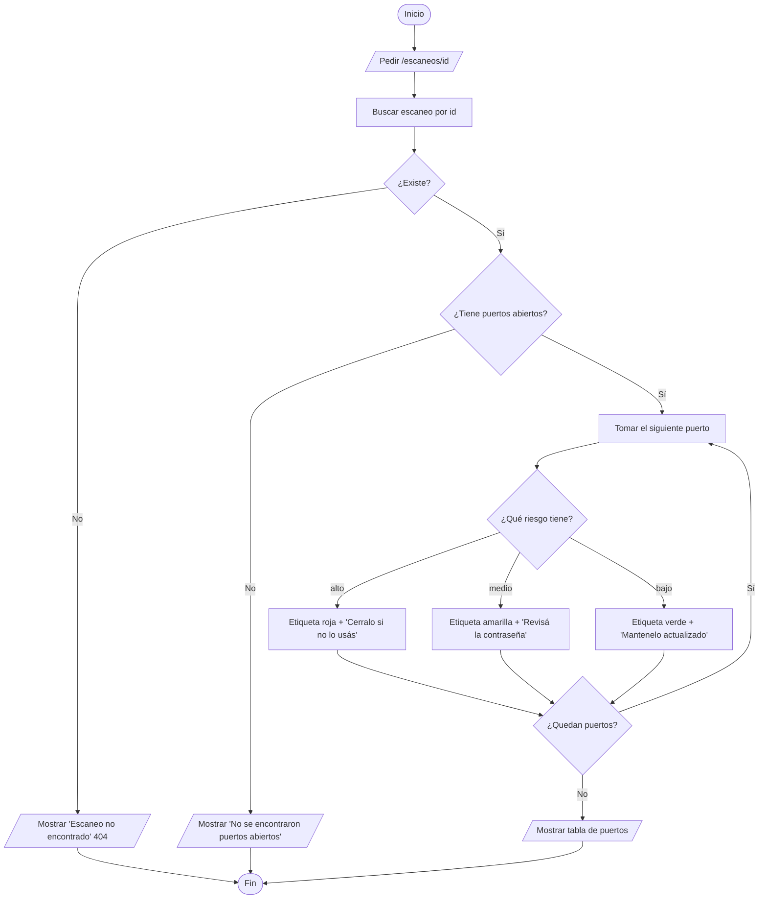

## US-4 Historial de escaneos

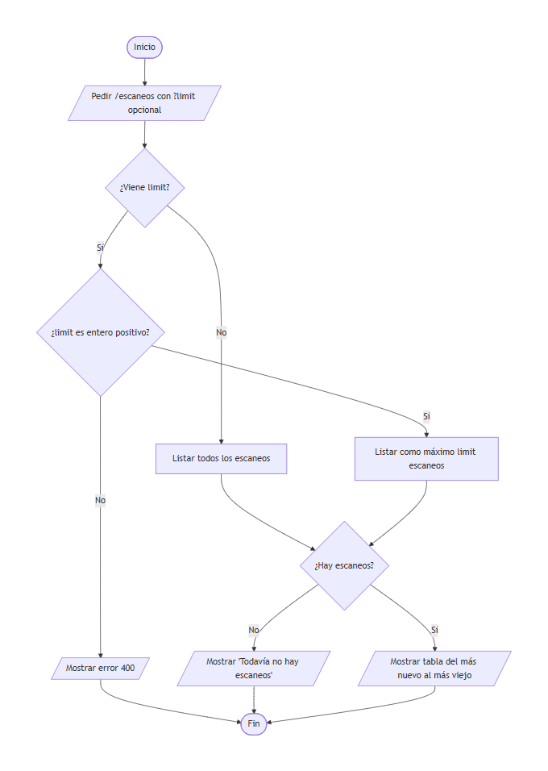

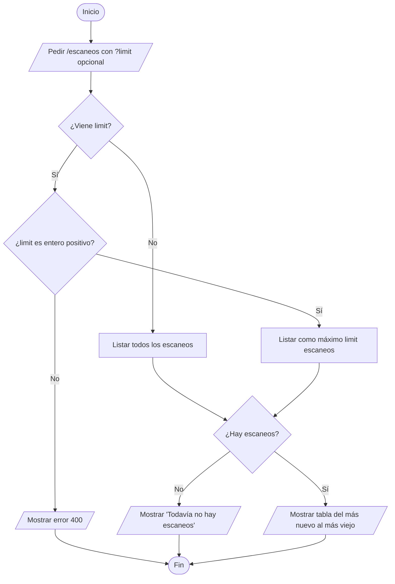

## US-5 Editar notas de un escaneo

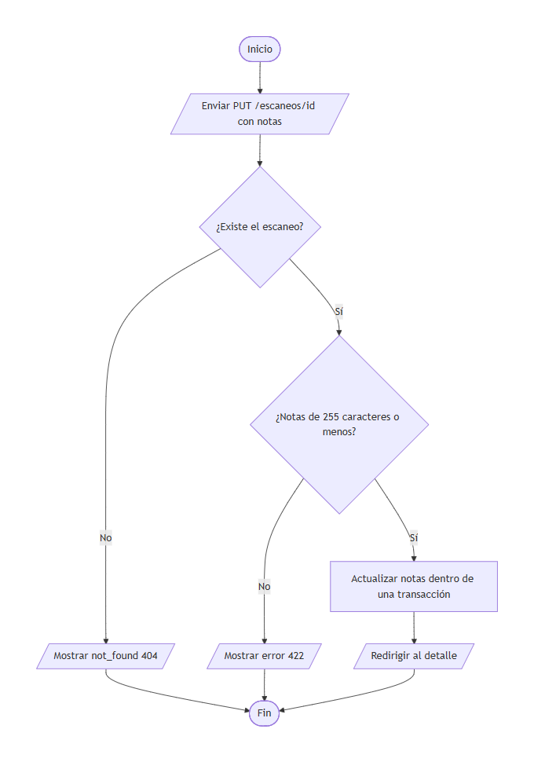

## US-6 Borrar un escaneo

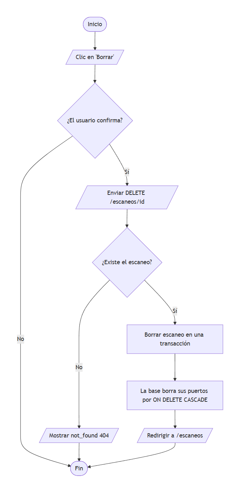

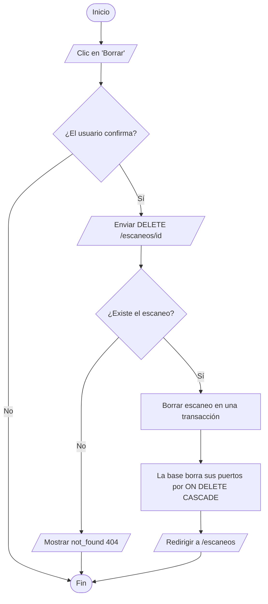
