# Checkpoint "Lógica de Programación Aplicada" — Diagramas de flujo

Un diagrama de flujo por cada historia de usuario del MVP (ver [TP15](TP15-backlog-mvp.md)).
Convenciones: **óvalo** = inicio/fin, **rombo** = decisión, **paralelogramo** = entrada/salida de datos, **rectángulo** = proceso.
Cada diagrama también está exportado a PNG en [`docs/diagramas/`](diagramas/).

## HU-01 Registro de usuario

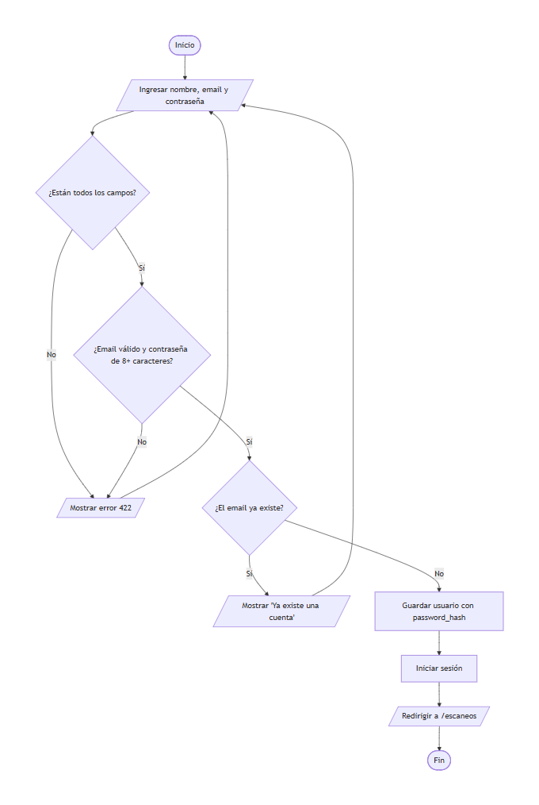

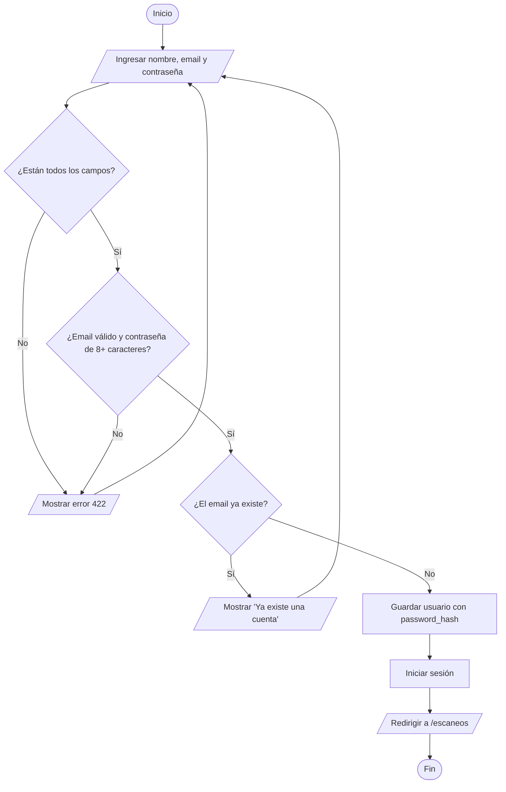

## HU-02 Inicio de sesión con email y contraseña

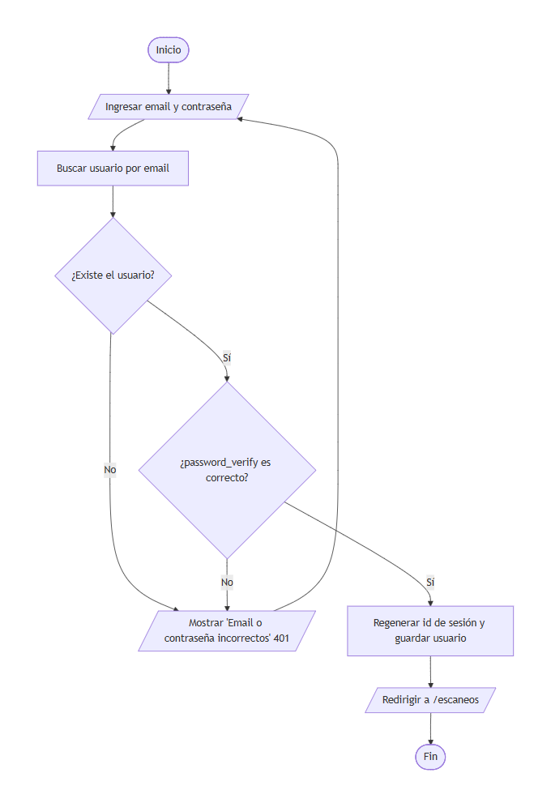

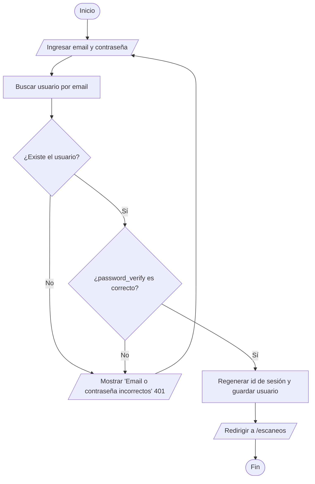

## HU-03 Nuevo escaneo

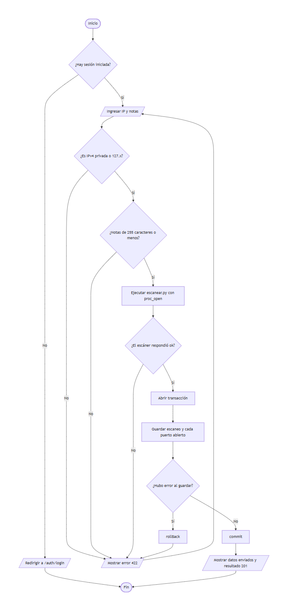

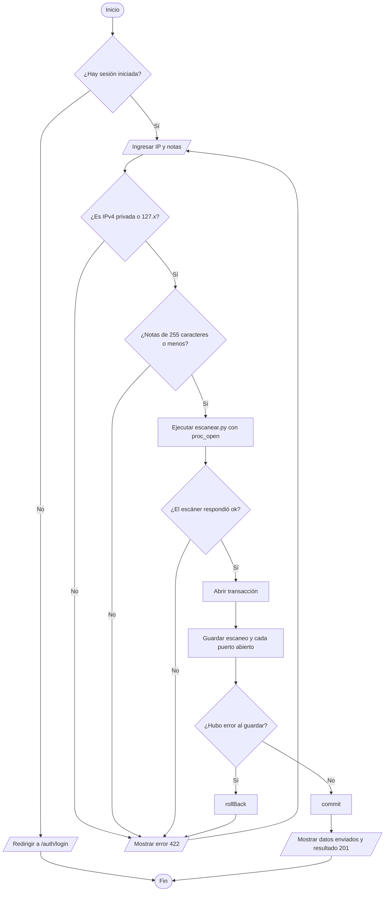

## HU-04 Ver resultado con riesgo

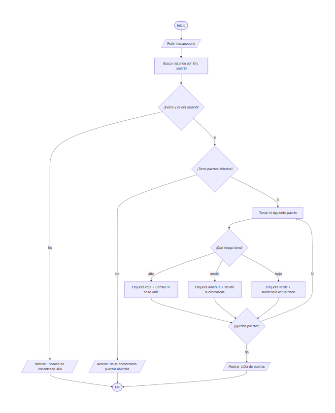

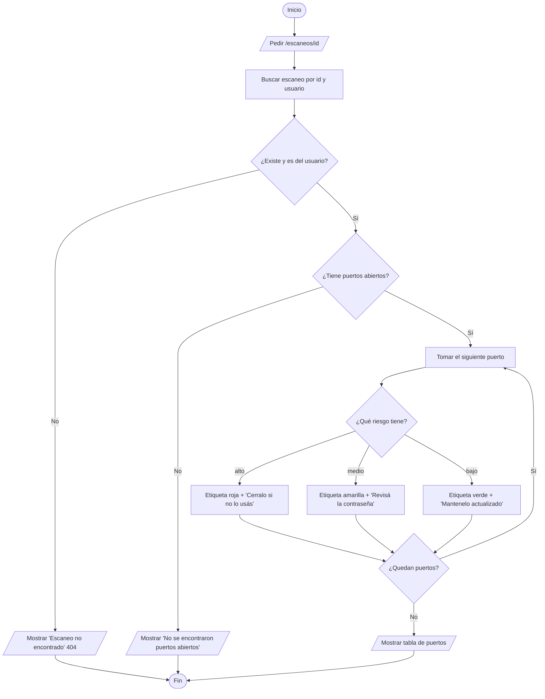

## HU-05 Historial de escaneos

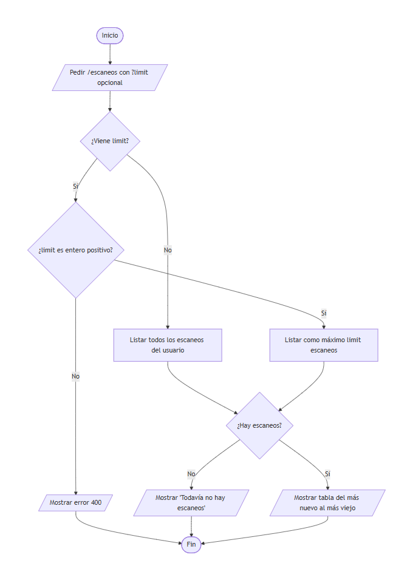

## HU-06 Editar notas de un escaneo

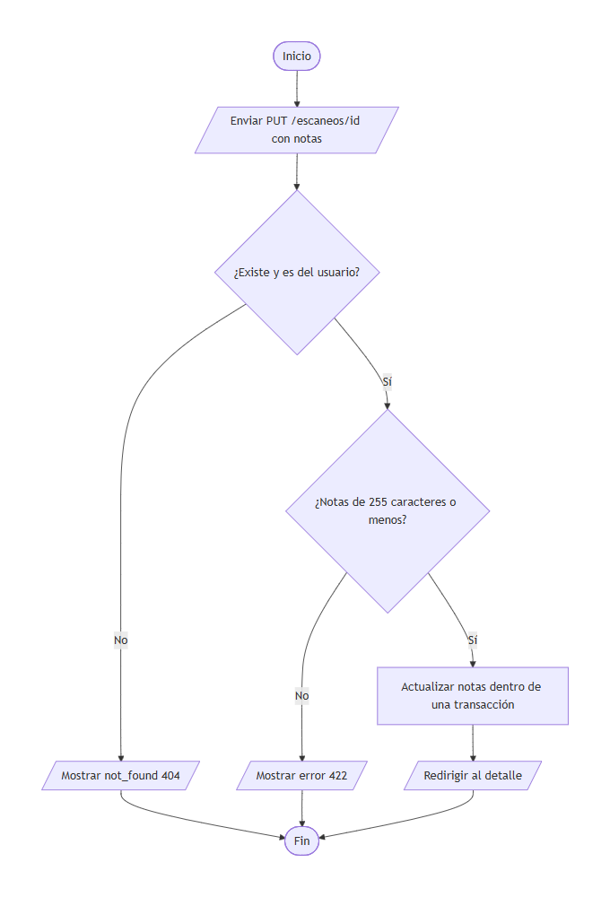

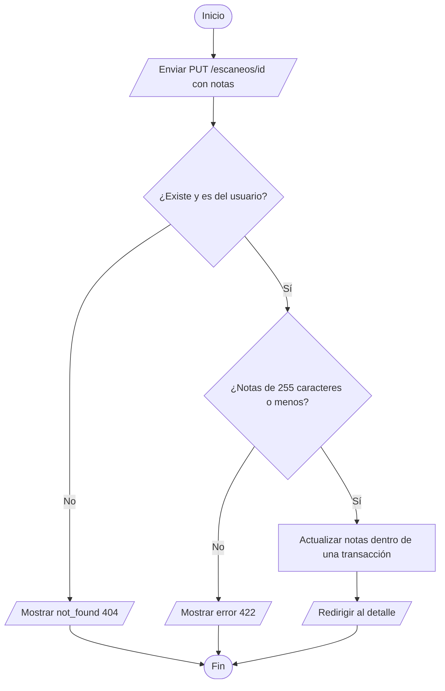

## HU-07 Borrar un escaneo

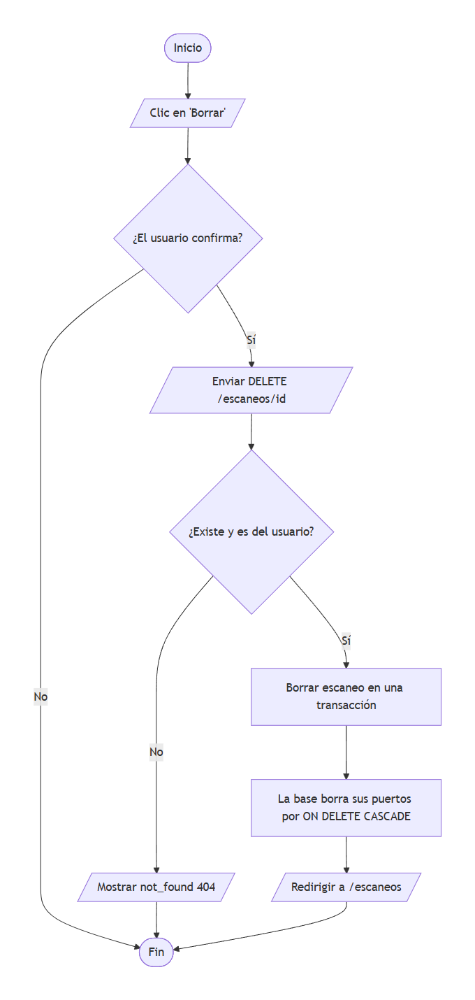

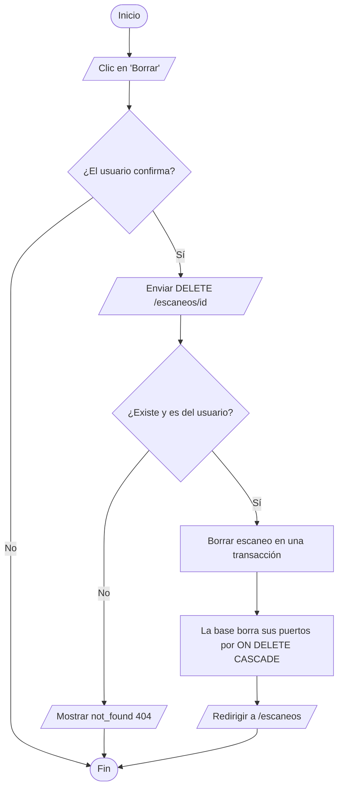

## HU-08 Ver la landing

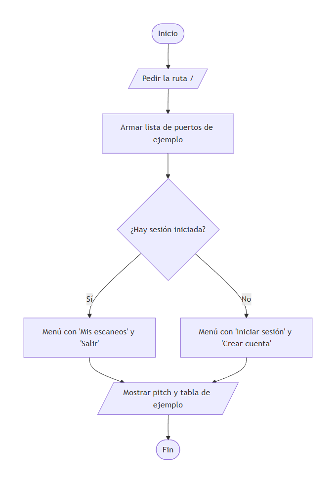

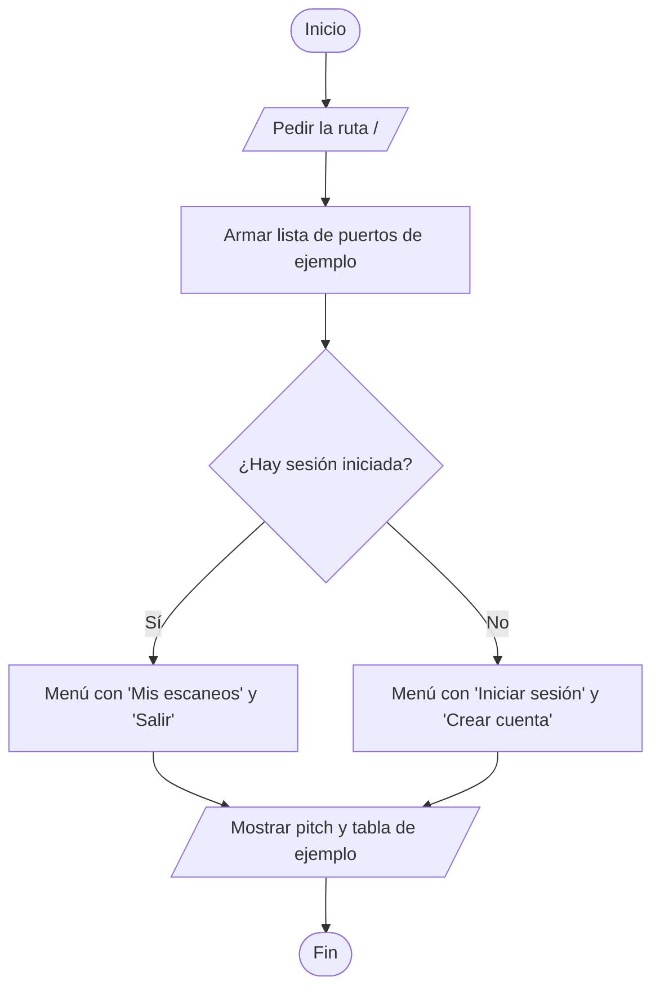
